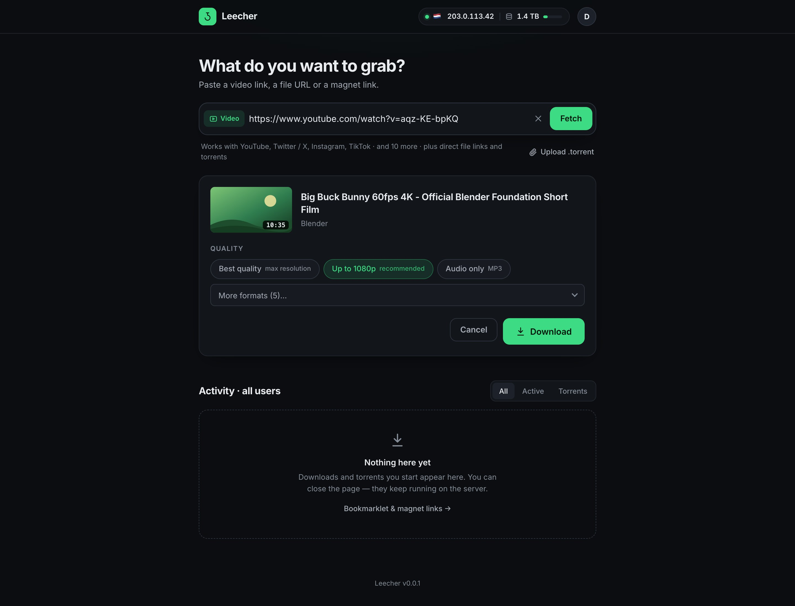

# leecher

Lightweight, self-hosted downloader with a web UI — videos, plain files and torrents in one place.

Paste a link from YouTube, Twitter, Instagram, TikTok, Reddit and dozens more, a direct file URL, or a magnet link — leecher picks the right engine. No cloud, no subscriptions — runs entirely on your own hardware, from a Raspberry Pi to a server or a container. Everything is behind a login with per-user accounts.



---

## Table of Contents

- [What It Does](#what-it-does)
- [Key Features](#key-features)
- [Quick Start](#quick-start)
- [Configuration](#configuration)
- [Accounts & Sign-in](#accounts--sign-in)
- [Download Engines](#download-engines)
- [Admin Panel](#admin-panel)
- [API Endpoints](#api-endpoints)
- [Disk Protection](#disk-protection)
- [Supported Sites](#supported-sites)
- [Platform Requirements](#platform-requirements)
- [Troubleshooting](#troubleshooting)
- [License](#license)

---

## What It Does

A single binary web server you run on any machine. Open the browser, paste a URL, pick a format, and the file downloads to your server. Everything stays on your hardware.

| Scope | What You See |
|-------|-------------|
| **Main UI** | Paste a video link, file URL or magnet; pick a format; download to your device or save on the server |
| **Torrents** | Magnets and `.torrent` files are handed to Transmission; each user sees and manages their own |
| **Activity** | One list of your downloads and torrents with live progress, speed and ETA; stop, pause, resume, retry failed downloads or save from any device |
| **Quality presets** | One-click Best quality, 1080p, and audio-only (MP3) |
| **Accounts** | Every page needs a login; admin/user roles; personal API tokens for scripts |
| **Admin panel** | Users, file manager, storage stats, runtime settings |
| **Disk protection** | Free space checks, storage caps, per-file size limits, auto-cleanup |

---

## Key Features

- **Web UI** — clean dark interface with neon green theme, works on desktop and mobile
- **Format selection** — fetch available formats before downloading, pick resolution/codec/size
- **Quality presets** — Best quality, 1080p, and audio-only (MP3) one-click options
- **Real-time progress** — WebSocket-powered live progress ring, percentage, speed, and ETA (with polling fallback)
- **Accounts** — the whole app sits behind a login: multiple users, admin/user roles, bcrypt passwords, forced password change for new accounts
- **API tokens** — per-user bearer tokens for scripts, phone shortcuts and the bookmarklet; limited to the download API
- **Three engines** — yt-dlp for supported sites, a resumable direct downloader for plain file URLs, and Transmission for magnets / `.torrent` files
- **SSRF guard** — direct downloads can never reach private, loopback, link-local or cluster addresses, even through redirects or DNS tricks
- **Status pill** — one compact pill in the top bar shows the public IP and flag leecher downloads from, free disk space and, while downloading, the live download speed (leecher's own network receive rate, averaged over 10 s); click it for a panel with location, provider, kill switch state and every disk's usage and read/write speed
- **Kill switch** — optionally stop every download the moment the outbound IP is not one you allowed (e.g. the VPN dropped); torrents pause and resume automatically
- **Save, Keep or Delete** — every finished download can be saved to your device; press *Keep* to move it into the server library permanently, otherwise it expires after `max_file_age_minutes`
- **Retry failed downloads** — failed or stopped downloads with a source link have a *Retry* button. It replaces the failed row with a fresh attempt, preserving the owner, title, format and destination; the original stays in admin history. Duplicate retries of the same failed attempt are blocked. If starting the retry fails, the original stays visible and retryable. Saved failures can also be retried after a restart. Older entries without a saved format recover MP3 ZIP mode for YouTube Music `/playlist?list=…` and SoundCloud `/sets/…` links; other links use the default quality. Uploaded `.torrent` files without a source link must be uploaded again.
- **Magnet links** — register Leecher as your browser's handler for `magnet:` links (Account page), so clicking one anywhere opens it here
- **Admin panel** — users, file manager, download history, yt-dlp updates, runtime settings including storage paths and Transmission
- **Live admin updates** — Server-Sent Events push file table changes to the admin panel in real time
- **Rate limiting** — per-user token-bucket rate limiting for format queries and downloads
- **FIFO queuing** — strict first-come-first-served queue for both format probes and downloads, with live position updates
- **Disk protection** — pre-download free space checks, storage caps, per-file size limits
- **Disk info** — free space is always visible in the status pill (amber when running low); admins also get a Storage panel with a one-click speed test
- **Auto-cleanup** — old files purged by age, storage limit enforced, orphan directories removed
- **Crash recovery** — stale job directories cleaned up automatically on startup
- **Cookie support** — pass browser cookies or a cookie file to yt-dlp for authenticated downloads
- **YouTube anti-throttle** — uses iOS player client to avoid DASH fragment 403 errors
- **Debug mode** — toggle yt-dlp log output on the download page from admin settings
- **Configurable timezone** — IANA timezone for all displayed timestamps (server-side and client-side)
- **Security** — CSRF protection, Content Security Policy, security headers, Secure/HttpOnly/SameSite cookies behind a TLS proxy
- **30+ platforms** — YouTube, Twitter/X, Instagram, TikTok, Reddit, Vimeo, SoundCloud, Twitch, and more
- **Single binary** — HTML, CSS, and JS embedded at compile time, nothing to configure
- **Cross-platform** — Linux (amd64/arm64/arm), macOS (amd64/arm64), Windows (amd64)
- **Runs as a systemd service** — starts on boot, restarts on failure
- **Installs yt-dlp and ffmpeg automatically** if missing
- **Automatic yt-dlp updates** — background check every 24 hours, or trigger manually from the admin panel
- **Structured JSON logging** — machine-readable logs via Go's slog
- **Graceful shutdown** — handles SIGINT/SIGTERM with timeout for clean process cleanup

---

## Quick Start

### 1. Download

Pick your platform:

| File | Platform |
|------|----------|
| `leecher-linux-arm64.tar.gz` | Raspberry Pi 3/4/5, ARM servers |
| `leecher-linux-amd64.tar.gz` | Standard Linux servers, desktops, VMs |
| `leecher-linux-arm.tar.gz` | Older ARM boards (32-bit) |
| `leecher-darwin-arm64.tar.gz` | macOS (Apple Silicon) |
| `leecher-darwin-amd64.tar.gz` | macOS (Intel) |
| `leecher-windows-amd64.zip` | Windows (64-bit) |

### 2. Install (Linux)

```bash
ARCH=$(uname -m); case $ARCH in x86_64) ARCH=amd64;; aarch64) ARCH=arm64;; armv7l|armv6l) ARCH=arm;; esac
curl -fsSL https://github.com/k-one-e/leecher/releases/latest/download/leecher-linux-${ARCH}.tar.gz | tar xz
sudo mv leecher /opt/leecher
cd /opt/leecher
sudo bash install.sh
```

This will:
1. Create a `leecher` system user
2. Install `yt-dlp` and `ffmpeg` if missing
3. Set up leecher as a system service (auto-starts on boot)

### 3. Start

```bash
sudo systemctl start leecher
```

### 4. Create the first account

```bash
cd /opt/leecher
sudo -u leecher ./leecher --add-user <name> '<password>' admin
```

(A `config.json` that still has `admin_user` / `admin_hash` from an early install? That admin becomes an account automatically on first start.)

### 5. Open the UI

```
http://<your-ip>:9090
```

Replace `<your-ip>` with your machine's IP address (e.g. `192.168.1.50`) and sign in.

### Run on macOS / Windows

```bash
tar xzf leecher-darwin-arm64.tar.gz
cd leecher
cp config.json.example config.json
./leecher --add-user <name> '<password>' admin
./leecher
```

---

## Managing the Service

```bash
sudo systemctl start leecher       # start
sudo systemctl stop leecher        # stop
sudo systemctl restart leecher     # restart
sudo systemctl status leecher      # check if running
journalctl -u leecher -f           # view live logs
```

### Running Without systemd

```bash
cd /opt/leecher
bash run.sh
```

### Uninstall

```bash
cd /opt/leecher
sudo bash uninstall.sh
```

This stops the service, removes the `leecher` system user, and optionally deletes downloaded files. You can then delete `/opt/leecher` to remove everything.

---

## Configuration

Edit `/opt/leecher/config.json`:

```json
{
  "port": 9090,
  "host": "0.0.0.0",
  "downloads_dir": "./downloads",
  "max_file_age_minutes": 60,
  "download_timeout_minutes": 10,
  "max_concurrent_downloads": 4,
  "max_downloads_per_ip": 1,
  "download_queue_max": 20,
  "probe_concurrency": 2,
  "probe_queue_max": 50,
  "probe_timeout_secs": 600,
  "ytdlp_path": "yt-dlp",
  "auto_download_ytdlp": true,
  "cookies_from_browser": "",
  "cookies_file": "",
  "js_runtimes": "",
  "admin_user": "",
  "admin_hash": "",
  "session_hours": 72,
  "max_file_size_mb": 0,
  "max_storage_mb": 0,
  "min_disk_free_mb": 500,
  "rate_limit_formats": 5,
  "rate_limit_downloads": 3,
  "time_zone": "Europe/Berlin",
  "debug_mode": false
}
```

| Setting | Default | Description |
|---------|---------|-------------|
| `port` | `9090` | HTTP server port |
| `host` | `0.0.0.0` | Bind address |
| `downloads_dir` | `./downloads` | Where downloaded files are stored |
| `max_file_age_minutes` | `60` | Finished downloads that were not kept are deleted after this many minutes (e.g. `1440` = 1 day) |
| `download_timeout_minutes` | `10` | Kill downloads exceeding this duration |
| `max_concurrent_downloads` | `4` | Simultaneous download limit across all users (1–10) |
| `max_downloads_per_ip` | `1` | Max active downloads per user; additional requests queue automatically (1–10) |
| `download_queue_max` | `20` | Max queued + active downloads before rejecting new ones (1–200) |
| `probe_concurrency` | `2` | Simultaneous format probe limit (1–20) |
| `probe_queue_max` | `50` | Max queued + active format probes before rejecting new ones (1–500) |
| `probe_timeout_secs` | `600` | Timeout for format probe queue wait + execution (5–600) |
| `ytdlp_path` | `yt-dlp` | Path to yt-dlp binary |
| `auto_download_ytdlp` | `true` | Automatically download yt-dlp if not found |
| `cookies_from_browser` | `""` | yt-dlp `--cookies-from-browser` value (e.g. `chrome`) |
| `cookies_file` | `""` | Path to a Netscape-format cookies file for yt-dlp |
| `js_runtimes` | `""` | JavaScript runtimes for yt-dlp (e.g. `deno`, `nodejs`); auto-detected if empty |
| `admin_user` / `admin_hash` | `""` | Legacy single admin; only used to create the first account when `state/users.json` does not exist yet |
| `session_hours` | `72` | How long a sign-in session lasts (hours) |
| `max_file_size_mb` | `0` | Reject files larger than this (0 = no limit) |
| `max_storage_mb` | `0` | Total downloads folder cap; oldest files auto-deleted (0 = no limit) |
| `min_disk_free_mb` | `500` | Refuse downloads if free disk space is below this (MB) |
| `rate_limit_formats` | `5` | Per-user rate limit for format queries per minute (1–60) |
| `rate_limit_downloads` | `3` | Per-user rate limit for download requests per minute (1–60) |
| `time_zone` | `Europe/Berlin` | IANA timezone for displayed timestamps (e.g. `UTC`, `America/New_York`) |
| `debug_mode` | `false` | Show yt-dlp log output on the download page |
| `trusted_proxies` | `[]` | CIDRs of reverse proxies whose `X-Forwarded-For` / `X-Forwarded-Proto` are believed (e.g. `["10.0.0.0/8"]` for a proxy on a private network) |
| `library_dir` | `""` | Library folder for kept downloads. All downloads run in a hidden `.leecher` folder inside it (so they use that disk) and *Keep* moves them in instantly. Empty = no Keep; downloads use `downloads_dir` |
| `direct_downloads` | `true` | Allow plain http(s) file URLs that yt-dlp does not handle |
| `direct_timeout_minutes` | `240` | Timeout for direct file downloads (1–1440) |
| `allow_private_urls` | `false` | Lift the SSRF guard for direct downloads. Only for setups where every user may reach your internal network |
| `torrent_engine` | `builtin` | `builtin`, `transmission` or `off` |
| `seed_ratio` | `1` | Built-in engine: stop seeding at this upload ratio (0 = no ratio limit) |
| `seed_minutes` | `1440` | Built-in engine: stop seeding after this long (0 = don't seed) |
| `max_active_torrents` | `3` | Concurrent torrent downloads across all users (0 = unlimited) |
| `torrent_port` | `42069` | Peer listen port (0 = random) |
| `transmission_url` | `""` | Transmission RPC endpoint, e.g. `http://localhost:9091/transmission/rpc`; empty disables torrents |
| `transmission_download_dir` | `""` | Folder *inside the Transmission container* for new torrents; empty = Transmission's default |
| `transmission_user` / `transmission_password` | `""` | RPC credentials; the `TRANSMISSION_USER` / `TRANSMISSION_PASS` environment variables take precedence |
| `kill_switch` | `false` | Stop all downloads whenever the outbound IP is not in `kill_switch_ips` (see [Kill switch](#kill-switch)) |
| `kill_switch_ips` | `[]` | Allowed outbound IPs or CIDR ranges, e.g. `["212.104.214.18", "194.126.177.0/24"]`; required when the switch is on |
| `kill_switch_interval_secs` | `3` | How often the outbound IP is checked while the switch is on (1–300) |

Leecher keeps its own files next to the binary, or under `LEECHER_HOME` when that variable is set: `config.json`, `state/users.json` (accounts and API-token hashes), `state/torrents.json` (who added which torrent), `bin/yt-dlp` and `.cache/`.

After changing the config, restart the service:

```bash
sudo systemctl restart leecher
```

### Recommended Settings for Raspberry Pi

```json
{
  "max_concurrent_downloads": 2,
  "max_file_size_mb": 500,
  "max_storage_mb": 2048,
  "min_disk_free_mb": 1000,
  "max_file_age_minutes": 30
}
```

---

## Accounts & Sign-in

Every page and API call requires a signed-in user; only `/login`, `/healthz`, `/readyz` and static assets are public.

- **Roles** — `admin` (settings, users, all files, all torrents) and `user` (own downloads and torrents only).
- **Sessions** — HttpOnly, `SameSite=Lax` cookies (plus `Secure` when served over TLS or a trusted TLS proxy); every state-changing request needs the session's CSRF token.
- **New accounts** — created by an admin with a temporary password; the user must change it at first sign-in.
- **Brute-force protection** — login is throttled per IP and per account; failed logins for unknown and known users take the same time.
- **Files and jobs** — users can only see and download the results of their own jobs; admins see everything.

### Command-line account management

Works while the server is running (it picks up the change immediately) — handy for recovery, e.g. from a shell in the container:

```bash
./leecher --add-user <name> '<password>' [admin|user]
./leecher --reset-password <name> '<password>'
./leecher --delete-user <name>
```

### API tokens

Each user can create tokens on the **Account** page (`/account`). Only a hash is stored; the token is shown once. Tokens work on the download API (`/api/formats`, `/api/download`, `/api/status`, `/api/cancel`, `/api/torrents`, `/downloads/…`, `/ws/status`) but never on settings, users or token management, even for admins.

```bash
curl -X POST https://leecher.example.com/api/download \
  -H "Authorization: Bearer lch_…" -H "Content-Type: application/json" \
  -d '{"url": "https://example.com/file.iso", "destination": "library"}'
```

The Account page also offers a **bookmarklet** that opens the current page in leecher (`/?url=…` is pre-filled and fetched automatically).

---

## Download Engines

Leecher looks at each pasted URL and picks an engine:

| URL | Engine | Notes |
|-----|--------|-------|
| Supported platform (YouTube, Instagram, …) | yt-dlp | Format list, presets, ffmpeg merging, playlist ZIPs for SoundCloud |
| `magnet:` link or URL ending in `.torrent` | Built-in torrent engine (or Transmission) | `.torrent` URLs are fetched through the SSRF guard; `.torrent` files can also be uploaded on the main page |
| Any other http(s) URL | Direct download | Needs `direct_downloads`; web pages (HTML) are rejected |
| Known DRM service | — | Clear explanation instead of a failure |

**Direct downloads** probe the file first (name, size, type), honour `max_file_size_mb` and `min_disk_free_mb`, resume with HTTP Range requests after dropped connections, and report speed and ETA. Every connection is checked *after* DNS resolution and on every redirect: loopback, RFC 1918, link-local (cloud metadata), CGNAT, multicast, IPv6 ULA and IPv4-embedding IPv6 ranges are refused, and no proxy is used.

**Egress location** — leecher looks up its own public address (ipinfo.io, falling back to ipwho.is) through the same network client the downloads use, so the indicator follows VPN or gateway changes. The result is cached for 10 minutes; a manual re-check is throttled to once per 30 seconds. Only signed-in users can see it.

<a id="kill-switch"></a>**Kill switch** — for setups where downloads must only ever leave through a VPN. Turn it on under *Admin → Settings → Kill Switch*, press *Detect current IP* to add the address leecher uses right now (or enter addresses / CIDR ranges yourself) and save. While it is on, leecher looks up its outbound IP every `kill_switch_interval_secs` (plain-IP services: ipify, checkip.amazonaws.com, icanhazip — IPv4, fresh connection each time), and every new download, link check or torrent start re-checks if the last answer is older than that. If the IP is not on the list, **or cannot be determined at all**, the switch trips:

- video and direct downloads are stopped and their partial files deleted (Activity shows why),
- built-in torrents are paused and the torrent engine is shut down completely (no peers, trackers or DHT); downloaded pieces are kept,
- running torrents in an external Transmission are stopped,
- new downloads, link checks, thumbnails and the daily yt-dlp update are refused.

As soon as an allowed IP is seen again — or the switch is turned off — paused torrents resume and the Transmission torrents it stopped are started again; stopped video/direct downloads have to be restarted. The egress indicator turns red while tripped, and a shield marks it while armed. On startup, leecher checks the IP before resuming any torrent. Limits: the check runs every few seconds, so traffic can flow for up to one interval after the route changes; it watches the IPv4 address only, and it cannot control an external Transmission's own web UI.

**Save, Keep, Delete** — there is no up-front choice of destination. Every download lands in a hidden working folder (`<library_dir>/.leecher`, or `downloads_dir` without a library). When it finishes you can:

- **Save** it to the device you are using (`/api/files/{id}`; supports resuming),
- **Keep** it — it is moved into `library_dir` (same disk, instant) and never expires; Save keeps working,
- **Delete** it, or do nothing and it expires after `max_file_age_minutes`.

Finished downloads are listed from the persistent history, so Save links survive restarts. Failed entries and entries whose file was deleted or expired leave the list after 24 hours, or right away with *Clear* / the ✕ on the item; the admin history keeps them. API clients can still send `"destination": "library"` to keep a download automatically.

**Magnet links** — on the Account page, *Open magnet links with Leecher* registers the site as the browser's `magnet:` handler (Chrome, Edge, Brave, Firefox; not Safari). Clicking a magnet link anywhere then opens Leecher with it pre-filled.

**Torrents (built-in engine, default)** — Leecher includes a pure-Go BitTorrent client ([anacrolix/torrent](https://github.com/anacrolix/torrent), MPL-2.0). Torrents are ordinary downloads: they show progress, speed, peers and ETA in Activity, can be paused and resumed (a pause survives restarts and is not undone by the kill switch) or stopped, and finish into the work area like everything else, so **Save / Keep / Delete** apply (a multi-file torrent is a folder; Save streams it as a ZIP). Afterwards the torrent seeds until `seed_ratio` or `seed_minutes` is reached, or until Keep/Delete. Unfinished torrents resume after a restart. Peers on private/local addresses are never contacted (same idea as the SSRF guard). No port forwarding is required; it only speeds up downloads if you add one for `torrent_port`.

**Torrents via Transmission (optional)** — set `torrent_engine` to `transmission` to hand torrents to an external Transmission instead (`transmission_url`, `transmission_download_dir`). The main page then lists Transmission's torrents with pause/resume/remove; admins see all and who added them.

---

## Admin Panel

Visit `/admin` as an admin (there is also an *Admin* link in the footer). The admin panel provides:

- **Users** — add users, change roles, reset passwords (forces a change at next sign-in), delete users; the last admin cannot be removed or demoted
- **File manager** — view, download, and delete files in the downloads directory
- **Settings** — edit all runtime settings, including the library folder, direct downloads, Transmission (with a *Test saved connection* button) and the kill switch (with *Detect current IP* and a live status line), and persist them to `config.json` without restarting
- **Stats** — total file count, storage used, free space
- **Storage** — each disk leecher writes to (downloads, library) with size, free space, live read/write throughput from `/proc/diskstats` (Linux) and a *Speed test* button that writes and reads back a 256 MB file to measure sequential speed
- **Download history** — recent jobs with status, URL, user, destination and timestamps
- **yt-dlp update** — trigger a yt-dlp update directly from the admin panel
- **Real-time file updates** — file table and history update automatically via SSE when downloads complete or files are deleted

Your own password and API tokens are managed on the **Account** page.

---

## API Endpoints

| Method | Path | Description |
|--------|------|-------------|
All endpoints require a session cookie (+ `X-CSRF-Token` header for non-GET) or, where marked 🔑, an API token (`Authorization: Bearer lch_…`).

| Method | Path | Description |
|--------|------|-------------|
| `POST` | `/login`, `/logout` | Sign in (form) / sign out |
| `POST` | `/api/formats` 🔑 | Probe a URL: formats (yt-dlp), file info (direct) or torrent name (SSE stream) |
| `POST` | `/api/download` 🔑 | `{"url", "format_id"?, "destination"?: "device"\|"library"}` — starts a job, or adds a torrent and returns `{"torrent": …}` |
| `GET` | `/api/status/{id}` 🔑 | Poll job progress (owner, admin, or job token) |
| `WS` | `/ws/status/{id}` 🔑 | WebSocket real-time progress updates |
| `POST` | `/api/cancel/{id}` 🔑 | Cancel a running download |
| `GET` | `/api/jobs` 🔑 | Your downloads: running jobs plus recent history, with file links and expiry |
| `GET` | `/api/files/{id}` 🔑 | Download a finished file (owner or admin; Range supported) |
| `POST` | `/api/jobs/{id}/keep` 🔑 | Move a finished download into the library |
| `POST` | `/api/jobs/{id}/retry` 🔑 | Start a new attempt for a failed or stopped download using its original link, format and destination; owners and admins only |
| `POST` | `/api/jobs/{id}/pause`, `/api/jobs/{id}/resume` 🔑 | Pause / resume a built-in torrent |
| `DELETE` | `/api/jobs/{id}/file` 🔑 | Delete a finished download's file |
| `DELETE` | `/api/jobs/{id}` 🔑 | Remove a finished/failed entry from your activity list (history keeps it) |
| `POST` | `/api/jobs/clear` 🔑 | Remove all failed entries and entries whose file is gone from your list |
| `GET` | `/api/disk` | Free/used/total space and live read/write rate per disk, plus leecher's network `rx`/`tx` rate (Linux, 10 s average); admins also get paths, device name and last speed test |
| `GET` | `/api/egress` | Public IP, city, country and network leecher downloads from (`?refresh=1` re-checks; cached 10 min) |
| `GET` | `/api/torrents` 🔑 | List your torrents (admins: all) |
| `POST` | `/api/torrents/upload` 🔑 | Add a `.torrent` file (multipart field `file`) |
| `POST` | `/api/torrents/{hash}/{start\|stop\|remove\|remove-data}` 🔑 | Control one of your torrents |
| `GET` | `/api/account` | Your profile and tokens |
| `POST` | `/api/account/password` | Change your password |
| `POST`/`DELETE` | `/api/account/tokens[/{id}]` | Create / revoke an API token |
| `GET`/`POST` | `/api/admin/users` | List / create users (admin) |
| `POST`/`DELETE` | `/api/admin/users/{name}` | Change role or reset password / delete (admin) |
| `GET` | `/api/admin/transmission-test` | Check the saved Transmission connection (admin) |
| `POST` | `/api/admin/disk-bench?disk={id}` | Run a 256 MB sequential write/read speed test on one disk (admin; one at a time) |
| `GET` | `/api/admin/killswitch` | Kill switch state; `?detect=1` looks up the current outbound IP (admin) |
| `GET` | `/api/admin/files` | List downloaded files (admin) |
| `POST` | `/api/admin/delete/{filename}` | Delete a file (admin) |
| `GET`/`POST` | `/api/admin/settings` | Get / update settings (admin) |
| `GET` | `/api/admin/history` | Download history (admin) |
| `POST` | `/api/admin/update-ytdlp` | Trigger yt-dlp update (admin) |
| `GET` | `/api/admin/events` | SSE stream for file change notifications (admin) |
| `GET` | `/healthz`, `/readyz` | Health probes (public) |

---

## Disk Protection

Leecher is designed to run unattended on low-storage devices:

1. **Pre-download disk check** — refuses downloads if free space is below `min_disk_free_mb`
2. **Pre-download storage check** — if `max_storage_mb` is set, auto-evicts oldest files to make room
3. **Per-file size limit** — passes `--max-filesize` to yt-dlp when `max_file_size_mb` is set; direct downloads check the announced size and stop mid-transfer if exceeded
4. **Age-based cleanup** — every 5 minutes, files older than `max_file_age_minutes` are deleted
5. **Orphan cleanup** — leftover job directories from crashes are removed on startup and periodically

Kept files in the library folder are never cleaned automatically; the age and storage limits only apply to downloads that were not kept.

The status pill shows the free space on the fullest disk and turns amber when it drops below twice `min_disk_free_mb` or under 5% of the disk, so you can clean up before downloads start being refused.

---

## Supported Sites

YouTube, Twitter/X, Instagram, TikTok, Reddit, Vimeo, SoundCloud, Twitch, Facebook, Dailymotion, Bandcamp, Bilibili, Nicovideo, Threads — and any other site supported by [yt-dlp](https://github.com/yt-dlp/yt-dlp/blob/master/supportedsites.md).

---

## Platform Requirements

- **Linux** — amd64, arm64, arm (Raspberry Pi 3/4/5, any ARM board)
- **macOS** — Apple Silicon (arm64) and Intel (amd64)
- **Windows** — 64-bit (amd64)
- **Dependencies** — `yt-dlp` and `ffmpeg` (auto-installed by `install.sh` on Linux, or downloaded automatically on first run)

---


## Troubleshooting

### Downloads fail immediately

- Check that yt-dlp is installed: `which yt-dlp`
- Check logs: `journalctl -u leecher --since "5 min ago"`
- Try updating yt-dlp: `sudo yt-dlp -U`

### "Requested format is not available"

Some sites only offer limited formats. Use the "Best quality" preset, which automatically selects the highest available.

### YouTube rate limiting (HTTP 403/429)

YouTube throttles frequent requests and blocks DASH fragment downloads with 403 errors. Leecher uses the iOS player client by default to avoid fragmented streams. Additional options:
- Set `cookies_from_browser` to your browser name (e.g. `chrome`) in `config.json`
- Or export cookies to a file and set `cookies_file`
- Make sure yt-dlp is up to date (update from admin panel or `sudo yt-dlp -U`)

### Nobody can sign in

If the log says *No user accounts exist*, create one with `./leecher --add-user <name> '<password>' admin`. A forgotten password is reset with `--reset-password`.

### "That address points to a private or local network"

Direct downloads refuse internal addresses on purpose (SSRF protection). Only if every user is fully trusted, set `allow_private_urls` to `true` in `config.json`.

### Torrents don't show up

Check *Settings → Transmission RPC URL* and use *Test saved connection*.
### Service won't start

```bash
sudo systemctl status leecher
journalctl -u leecher -f
```

Check for port conflicts (`lsof -i :9090`) or config syntax errors.

---

## License

Proprietary — free for personal and non-commercial use.
